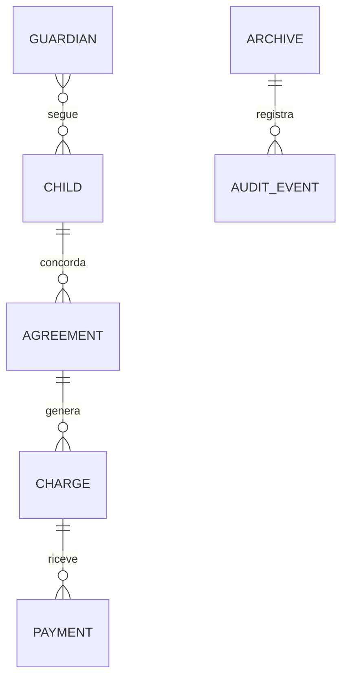

# Architettura e sviluppo incrementale

## Separazione delle responsabilità

| Parte | File | Contratto |
|---|---|---|
| Dominio | `src/domain.ts` | Funzioni senza I/O, denaro intero, date civili, invarianti |
| Dati iniziali | `src/demo.ts` | Quattro famiglie di fantasia al primo avvio |
| Archivio | `src/persistence.ts` | Validazione, revisione attesa, backup precedente, salvataggio esplicito |
| Gestione dati | `src/management.ts` | Rimozioni coerenti, correzioni economiche e azzeramenti |
| Interfaccia | `src/App.tsx`, `components.tsx`, `dialogs.tsx` | UI italiana, moduli reali, conferme per storni/ripristino |
| Desktop | `src-tauri/` | Finestra, menu, istanza singola, archiviazione nativa, installer |
| Cloud futuro | `supabase/` | Schema relazionale, Auth owner, RLS, test da eseguire |

Il dominio non dipende né da React né da Supabase. Per sostituire l'archivio locale
con il cloud non si riscrivono calcoli e comportamenti già coperti dai test.

## Entità

Ogni scadenza conserva importo e periodo emessi. I pagamenti puntano a una
scadenza; gli storni aggiungono stato, data e motivo. Le chiavi di emissione
rendono idempotente la generazione ricorrente. I tutori condivisi permettono
di non duplicare il contatto di un genitore con più figli.

## Persistenza V0.1

In Tauri si usa il plugin ufficiale Store nella cartella dati dell'app. Prima di
caricarlo, il file è letto e validato: StoreBuilder può ignorare errori di parsing,
quindi l'app impedisce che un archivio corrotto venga scambiato per un primo avvio.
La copia precedente usa un file separato. Il formato nativo è `{ "archive": ... }`.

La 0.1.1 aggiunge `memoles-world-safety.json`, con gli ultimi 5 archivi completi
prima di operazioni protette. Il salvataggio della copia precede sia il backup
rotante sia il nuovo archivio: se fallisce, la modifica non viene applicata.
Le copie vengono validate prima di essere lette o aggiornate e sono ripristinabili
dalla UI. Il permesso filesystem aggiunto riguarda solo questo file preciso.

In anteprima si usa `localStorage`, separato dall'archivio Tauri. Il repository ha
lo stesso contratto. Web Locks serializza i salvataggi nelle schede dello stesso
browser; un controllo di revisione impedisce scritture con stato obsoleto.
L'app nativa usa anche il plugin Single Instance.

La UI viene aggiornata solo dopo il salvataggio confermato. Il backup precedente
è scritto prima dell'archivio principale; un errore ferma l'operazione. Non sono
transazioni di database né una garanzia contro ogni guasto hardware: backup
esportati regolari e prova di recupero restano necessari. La copia precedente
ruota a ogni modifica riuscita, quindi non è un archivio di versioni a lungo termine.

Import: massimo 8 MB, JSON/schema/versione, UUID, riferimenti, unicità e saldi
validati. Prima di sovrascrivere viene chiesta una conferma con riepilogo.
La validazione non prova l'autenticità di un backup modificato manualmente.

L'archiviazione del tutore usa il campo facoltativo `active`; l'assenza nei backup
precedenti equivale a `true`. Il formato locale resta schema 1 ed è compatibile
in lettura con i dati 0.1.0. La vecchia app non deve essere usata sui nuovi dati.

## Confini di sicurezza

- Nessun segreto o richiesta cloud. CSP di produzione senza connessioni esterne.
- Permessi Tauri per sole operazioni Store necessarie, lettura del singolo
  archivio e scrittura del backup scelto nel dialogo di sistema.
- Nessun plugin shell, HTTP, updater, telemetria o accesso generico ai documenti.
- Font di sistema e illustrazione SVG locale; nessuna risorsa remota.
- Il prototipo non cifra i dati e non implementa login, ruoli o audit immutabile.
- La configurazione macOS richiede 13+, coerente con le API WebKit usate.

## Prossime tappe e relative condizioni di completamento

1. **Collaudo desktop Windows:** build release e NSIS riuscite, Cargo.lock generato;
   verificati avvio, Store su disco, copia precedente, riapertura, istanza singola
   e apertura del dialogo di salvataggio. Restano installazione/disinstallazione
   NSIS, scrittura e ripristino del backup mediante dialoghi e prova di recupero completa.
2. **Collaudo Mac:** build `.app`/`.dmg`, prova WebKit e MacBook reale, firma e
   notarizzazione. Conservare i test già passati senza riscrivere il dominio.
3. **Cloud:** eseguire migrazioni e test RLS/concorrenza, integrare Supabase Auth
   e adapter cloud; definire conflitti e importazione locale. Non attivare leggendo
   semplicemente variabili d'ambiente.
4. **Uso reale:** definire backup e recupero verificati, accessi, riservatezza dei
   dati dei minori e requisiti amministrativi. Validare i flussi con Hoara.

Nessuna integrazione presenze, promemoria automatici, invio messaggi, ricevuta
fiscale, multi-operatore o sincronizzazione è dichiarata nella V0.1.
